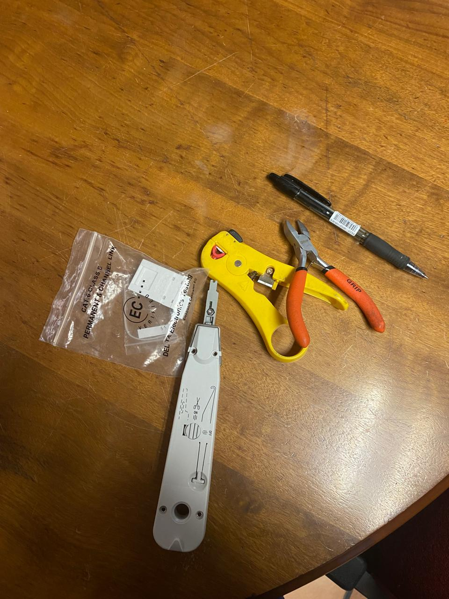
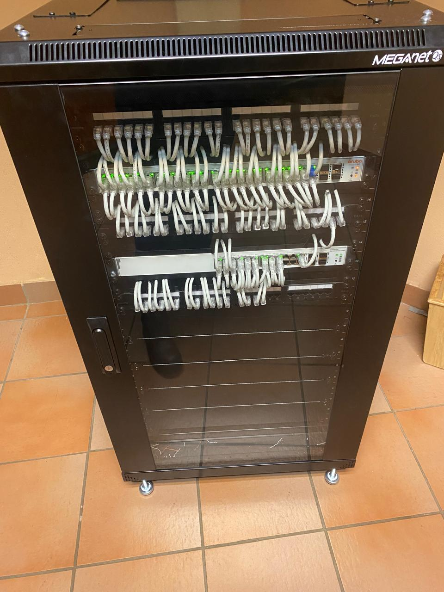
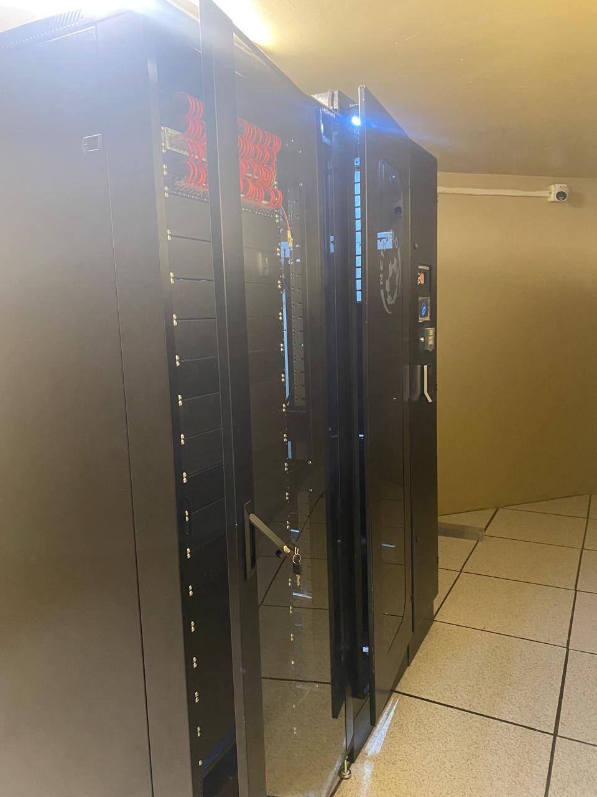
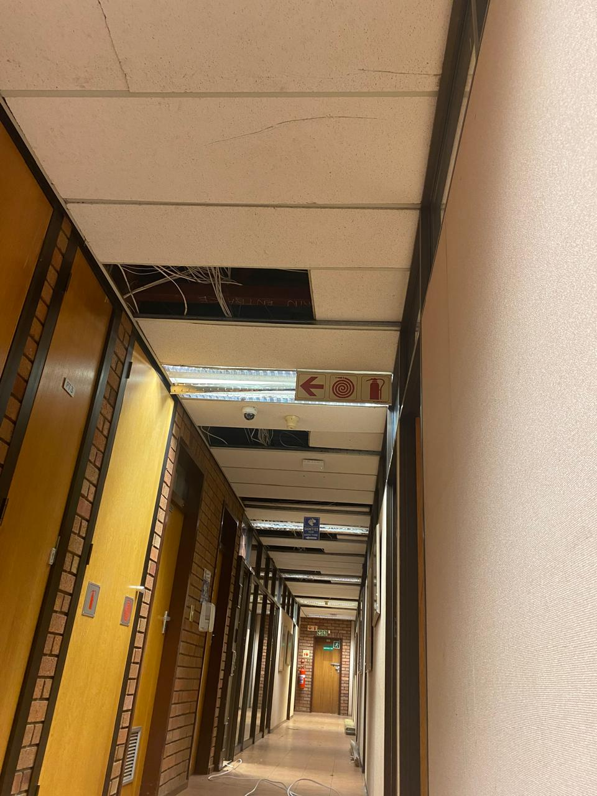
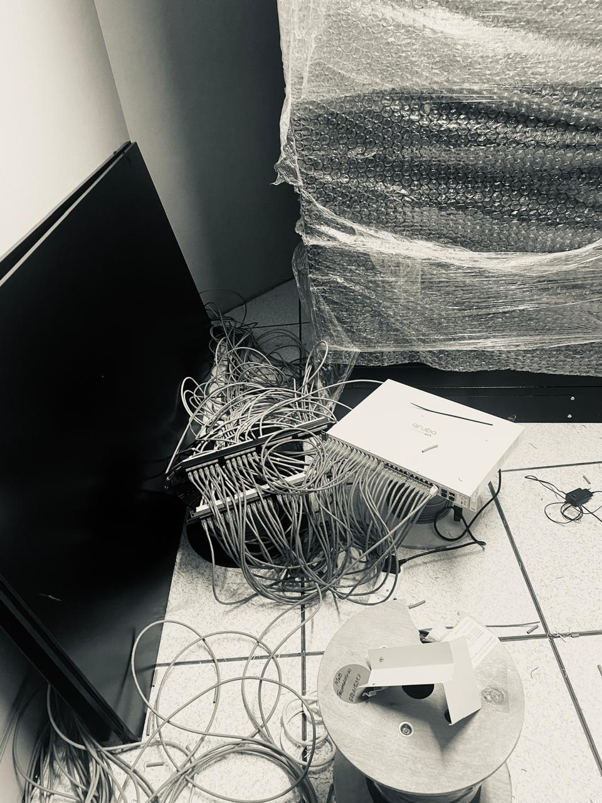
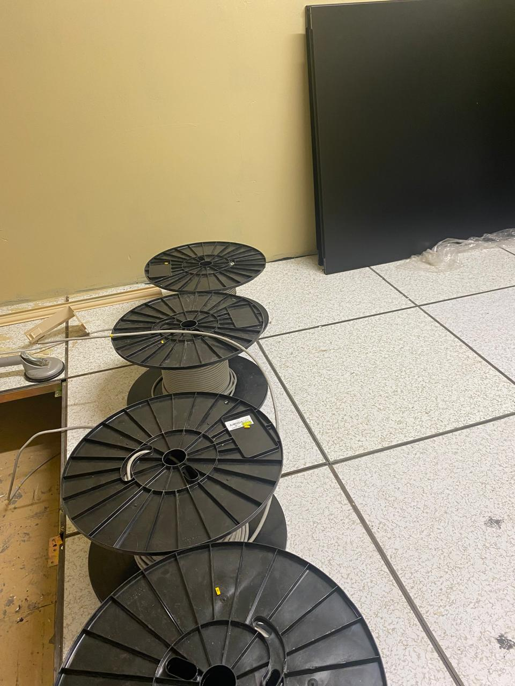
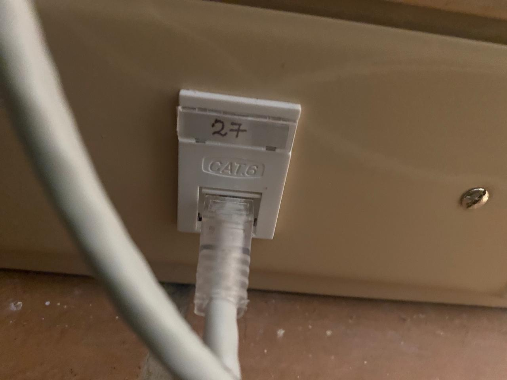

# Network Cabling and Infrastructure Installation

## Project Overview

This project showcases practical experience in network cabling and infrastructure installation. It documents the process of installing network cables, terminating network points, setting up network cabinets and working with various cabling tools and equipment.

## Technologies and Concepts

- Structured Network Cabling
- CAT6 Ethernet Cabling
- Network Point Termination
- Patch Panel Termination
- Network Cabinet Setup
- Network Infrastructure Installation

## Practical Work

- Installed and terminated network points.
- Worked with CAT6 network cables.
- Assisted with network cabinet setup.
- Performed network cabling and infrastructure installation.
- Used various tools and equipment for network cabling.

## Tools and Equipment

## Project Evidence

      

